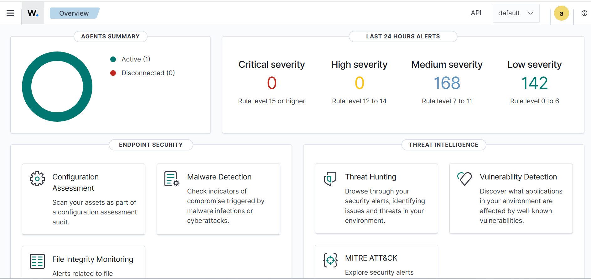
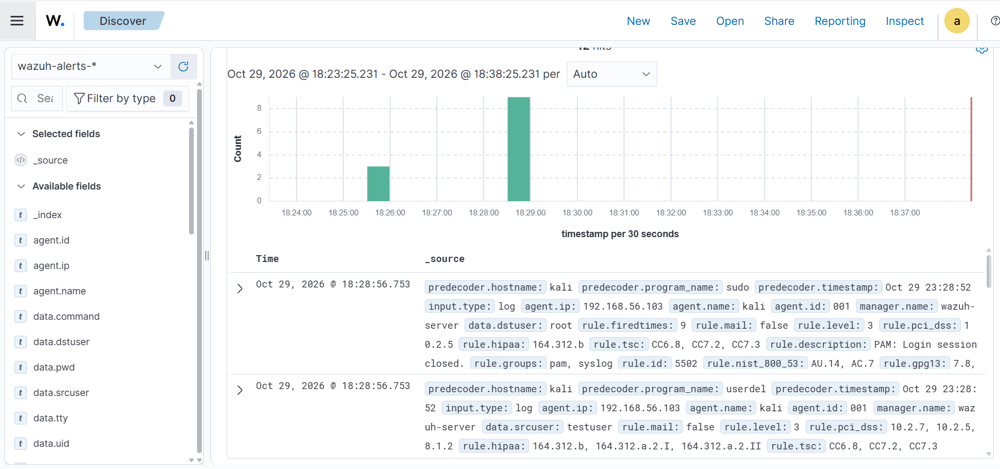
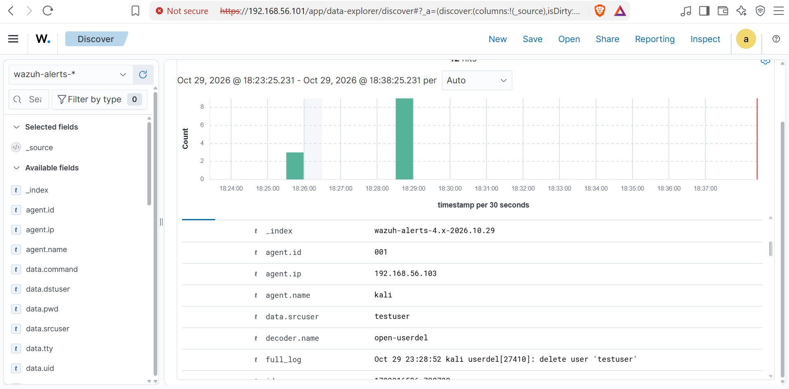
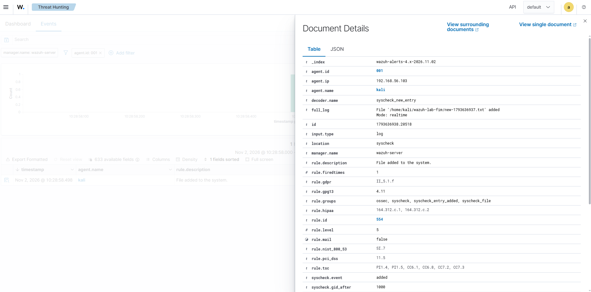
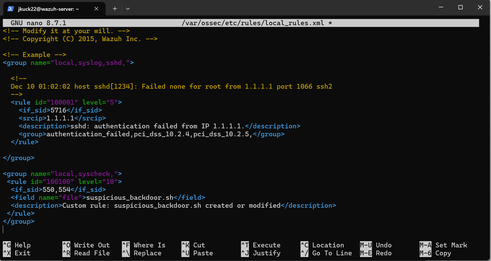
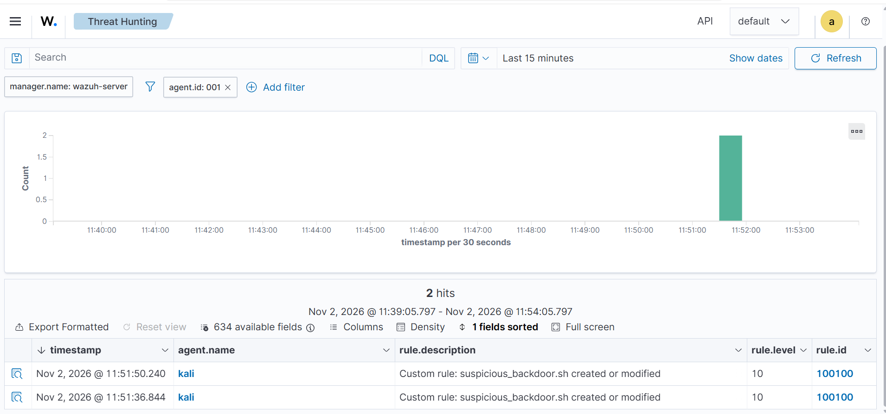
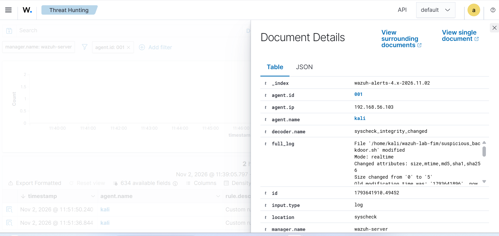
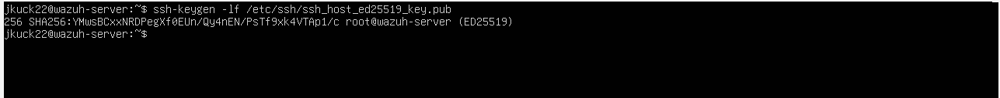

# Purple Team Lab – Wazuh SIEM + Kali + Metasploitable

A hands-on purple team lab demonstrating SIEM deployment, agent monitoring, file integrity monitoring, and custom detection engineering. Built as a portfolio project while studying cybersecurity.

## Lab Architecture

- **Wazuh Server** (Ubuntu 26.04 Server) – All-in-one manager, indexer, and dashboard
- **Kali Linux** – Attack platform with Wazuh agent installed
- **Metasploitable 2** – Intentionally vulnerable target
- **Networking** – VirtualBox host-only network (`192.168.56.0/24`)

---

## Part 1 – SIEM Deployment and Alert Investigation

### Dashboard Overview



Active agent reporting and alert volume from the last 24 hours.

### Security Events (Discover)



Timeline of alerts generated from activity on the Kali agent, including privilege escalation and user management events.

### Example Alert Detail



Expanded view of a `userdel` alert showing the full log, agent information, and decoded fields.

---

## Part 2 – File Integrity Monitoring (FIM)

Configured Wazuh's syscheck module on the Kali agent to monitor `/home/kali/wazuh-lab-fim` in **real-time mode**, so file changes are reported within seconds instead of on the default 12-hour scan.

When a test file was created, Wazuh generated built-in **rule 554 – "File added to the system" (level 5)**, with `Mode: realtime` confirmed in the log.



**Built-in FIM rules:**

| Rule ID | Event |
|---|---|
| 550 | File modified (checksum changed) |
| 553 | File deleted |
| 554 | File added |

FIM alerts are automatically mapped to compliance frameworks (PCI DSS 11.5, NIST 800-53 SI.7, HIPAA, GDPR), which is why FIM is a requirement in many regulated environments.

---

## Part 3 – Custom Detection Rule

### Goal

Escalate FIM alerts for a specific suspicious filename (`suspicious_backdoor.sh`) from a generic level 5 event to a high-priority level 10 detection.

### The Rule

Added to `/var/ossec/etc/rules/local_rules.xml` on the Wazuh server:

```xml
<group name="local,syscheck,">
  <rule id="100100" level="10">
    <if_sid>550,554</if_sid>
    <field name="file">suspicious_backdoor.sh</field>
    <description>Custom rule: suspicious_backdoor.sh created or modified</description>
  </rule>
</group>
```



### How It Works

| Element | Purpose |
|---|---|
| `id="100100"` | Custom rules use the 100000–120000 range to avoid collisions with built-in rules |
| `level="10"` | Raises severity from 5 to 10 so the alert stands out during triage |
| `<if_sid>550,554</if_sid>` | **Rule chaining** – only evaluated after the built-in "file modified" or "file added" rule fires |
| `<field name="file">` | Matches only when the file path contains `suspicious_backdoor.sh` |
| `local_rules.xml` | User-owned rules file that is preserved during Wazuh upgrades |

### Deployment

```bash
# Validate rule syntax without affecting the running service
sudo /var/ossec/bin/wazuh-analysisd -t

# Load the new rule
sudo systemctl restart wazuh-manager
sudo systemctl status wazuh-manager
```

Validating before restarting matters: a malformed rule can stop the manager from starting and leave the SIEM blind.

### Testing (Purple Team Validation)

On the Kali agent:

```bash
touch /home/kali/wazuh-lab-fim/suspicious_backdoor.sh          # triggers 554 -> 100100
echo "test" >> /home/kali/wazuh-lab-fim/suspicious_backdoor.sh  # triggers 550 -> 100100
```

### Result

Both actions generated **rule 100100 at level 10** from the Kali agent – one for file creation and one for modification.





---

## Part 4 – Secure Server Administration (SSH)

Moved server management from the VirtualBox console to SSH from the Windows host:

```powershell
ssh jkuck22@192.168.56.101
```

On first connection, SSH presented the server's ED25519 host key fingerprint. Before trusting it, the fingerprint was **verified out-of-band** from the VM console:

```bash
ssh-keygen -lf /etc/ssh/ssh_host_ed25519_key.pub
```

The fingerprints matched exactly, confirming the connection was going to the real server and not an impersonator (man-in-the-middle protection). The key is now stored in the client's `known_hosts`, so any future change will trigger a warning.



---

## What I Built

- Deployed a full Wazuh 4.14 all-in-one stack
- Configured host-only networking between all lab VMs
- Installed and connected a Wazuh agent on Kali
- Generated real alerts and investigated them in the dashboard
- Configured real-time File Integrity Monitoring on the Kali agent
- Wrote, validated, deployed, and tested a custom detection rule
- Set up SSH administration with out-of-band host key verification
- Documented compatibility challenges with legacy systems

## Key Learnings

- End-to-end SIEM deployment and troubleshooting
- Agent installation and connectivity verification
- Navigating and interpreting Wazuh/OpenSearch alerts
- File integrity monitoring and its role in compliance
- Detection engineering: chaining custom rules off built-in rules and tuning severity
- Safe change management: syntax validation before service restarts
- SSH host key verification and man-in-the-middle protection
- Linux file permissions on security tooling (Wazuh configs are root/wazuh-only by design)
- Purple team mindset: perform actions and immediately validate detection

## Challenges Overcome

- Ubuntu 26.04 not on the official supported list (used `-i` to bypass hardware checks)
- Disk space exhaustion during dashboard installation (expanded the virtual disk)
- VirtualBox soft lockups (resolved with CPU count and paravirtualization adjustments)
- Metasploitable 2 glibc too old for the modern Wazuh agent → monitored the attacker (Kali) instead, which is still a valid detection approach
- A misspelled rules file name (`loacl_rules.xml`) silently created a new empty file. Caught it before saving, since Wazuh loads every `.xml` in the rules directory and a stray file can break the manager
- `Permission denied` on `/var/ossec/etc/rules/`, which is restricted to root and the `wazuh` group by design. Used `sudo`
- No shared clipboard on the VirtualBox server console, so moved administration to SSH
- Look-alike characters (`l`, `i`, `1`) causing command errors on the console font, which reinforced reading error messages literally

## Tech Stack

- Wazuh 4.14
- Ubuntu Server 26.04
- Kali Linux
- Metasploitable 2
- VirtualBox
- OpenSSH

## Next Steps

- Write detections for common persistence techniques (e.g., changes to `~/.ssh/authorized_keys`, cron jobs, `/etc/passwd`) and map them to MITRE ATT&CK
- Add a modern vulnerable target with an agent
- Explore the Vulnerability Detection module
- Practice alert triage and tuning to reduce false positives
