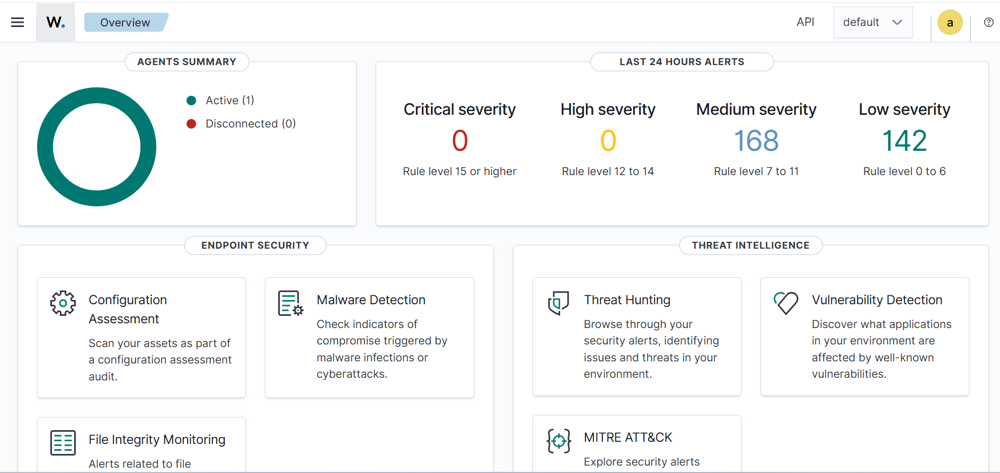
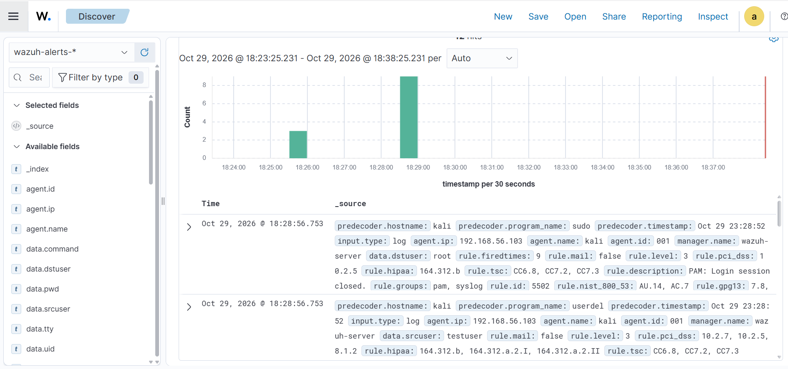
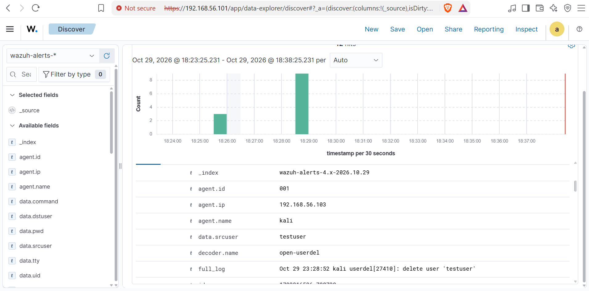

# Purple Team Lab – Wazuh SIEM + Kali + Metasploitable

A hands-on purple team lab demonstrating SIEM deployment, agent monitoring, and alert investigation. Built as a portfolio project while studying cybersecurity.

## Lab Architecture

- **Wazuh Server** (Ubuntu 26.04 Server) – All-in-one manager, indexer, and dashboard
- **Kali Linux** – Attack platform with Wazuh agent installed
- **Metasploitable 2** – Intentionally vulnerable target
- **Networking** – VirtualBox host-only network (`192.168.56.0/24`)

## Dashboard Overview

Active agent reporting and alert volume from the last 24 hours.

## Security Events (Discover)

Timeline of alerts generated from activity on the Kali agent, including privilege escalation and user management events.

## Example Alert Detail

Expanded view of a `userdel` alert showing the full log, agent information, and decoded fields.

## What I Built

- Deployed a full Wazuh 4.14 all-in-one stack
- Configured host-only networking between all lab VMs
- Installed and connected a Wazuh agent on Kali
- Generated real alerts and investigated them in the dashboard
- Documented compatibility challenges with legacy systems

## Key Learnings

- End-to-end SIEM deployment and troubleshooting
- Agent installation and connectivity verification
- Navigating and interpreting Wazuh/OpenSearch alerts
- Purple team mindset: perform actions and immediately validate detection
- Practical limitations when working with very old operating systems

## Challenges Overcome

- Ubuntu 26.04 not on the official supported list (used `-i` to bypass hardware checks)
- Disk space exhaustion during dashboard installation (expanded the virtual disk)
- VirtualBox soft lockups (resolved with CPU count and paravirtualization adjustments)
- Metasploitable 2 glibc too old for the modern Wazuh agent → monitored the attacker (Kali) instead, which is still a valid detection approach

## Tech Stack

- Wazuh 4.14
- Ubuntu Server 26.04
- Kali Linux
- Metasploitable 2
- VirtualBox

## Next Steps

- Write custom rules for specific attack patterns
- Add a modern vulnerable target with an agent
- Explore File Integrity Monitoring and Vulnerability Detection modules
- Practice alert triage and tuning
